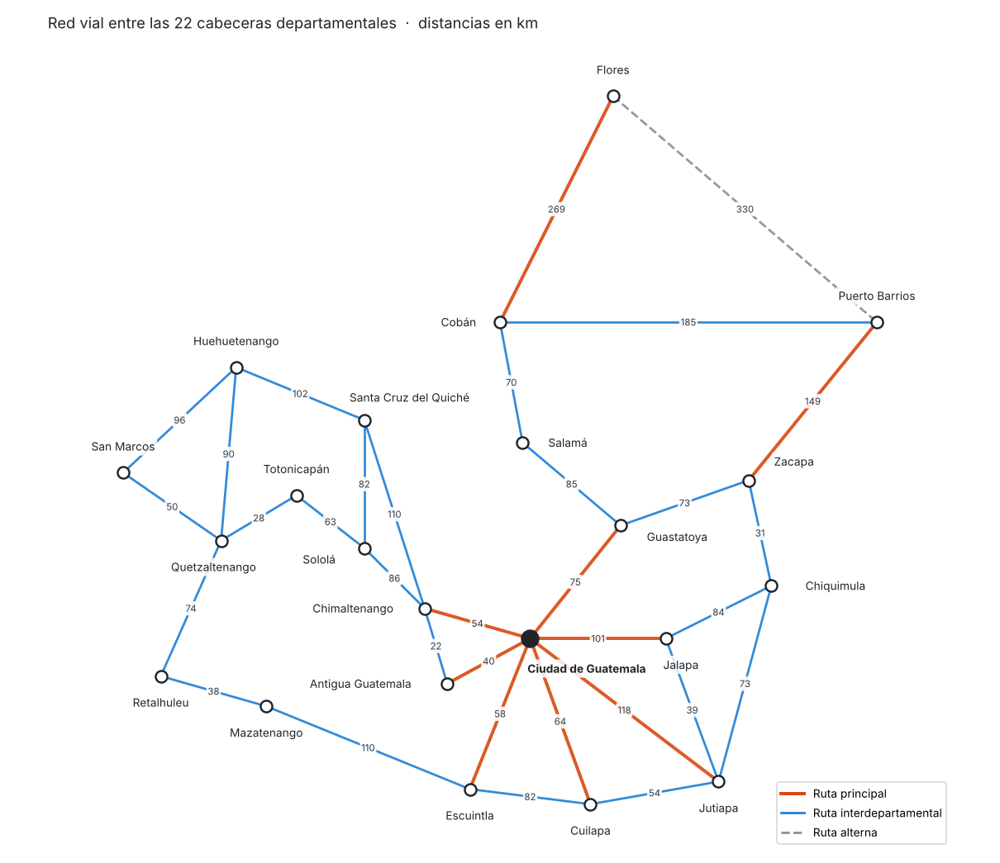
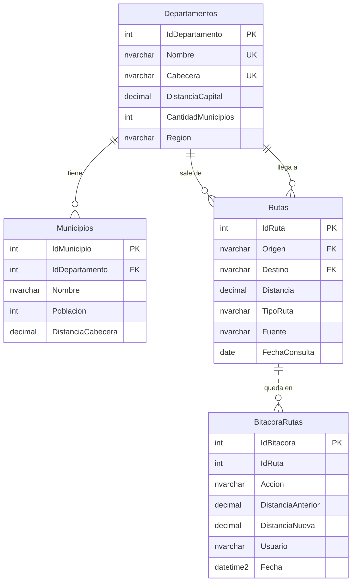

# Sistema Red Vial Guatemala

Consulta distancias entre departamentos, municipios y rutas de Guatemala.

Aplicación de escritorio en C# con SQL Server, hecha para el curso de Bases de Datos de la Universidad Mariano Gálvez.



## Qué hace

- Te dice a cuántos kilómetros está cualquier departamento de la capital.
- Lista los municipios de cada departamento con su población y su distancia a la cabecera.
- Calcula la distancia aproximada de la capital a cualquiera de los 340 municipios.
- Revisa si hay ruta directa entre dos cabeceras y muestra todas las conexiones que salen de una ciudad.
- Enseña los recorridos del árbol (InOrden, PreOrden y PostOrden) y el camino que sigue al buscar un departamento.

| Dato | Cantidad | Detalle |
|---|---|---|
| Departamentos | 22 | Cabecera, región y distancia a la capital |
| Municipios | 340 | Población y distancia a su cabecera |
| Rutas | 33 | Entre cabeceras, con distancias tomadas de Google Maps |

## La base de datos

Todo está en la carpeta [`BaseDatos`](BaseDatos), separado en scripts que se corren en orden:

| Script | Qué tiene |
|---|---|
| `01_estructura.sql` | Crea la base, las tablas, las llaves, las restricciones y los índices |
| `02_datos.sql` | Los 22 departamentos, los 340 municipios y las 33 rutas |
| `03_vistas.sql` | Vistas con los datos ya cruzados y resumidos |
| `04_funciones.sql` | Funciones de distancia y conexiones |
| `05_procedimientos.sql` | Procedimientos para buscar, calcular rutas y registrar cambios |
| `06_triggers.sql` | Conteo automático de municipios y bitácora de rutas |
| `07_consultas.sql` | Consultas de ejemplo para probar todo |



**Reglas que cuida la base**

- Cada ruta tiene que salir y llegar a una cabecera que exista, por eso Origen y Destino son llaves foráneas a `Departamentos.Cabecera`.
- No se puede guardar la misma ruta dos veces, ni al revés. Si existe Zacapa → Chiquimula, no entra Chiquimula → Zacapa. Esto se logra con dos columnas calculadas que ordenan el tramo y un `UNIQUE` sobre ellas.
- No hay distancias negativas, una ruta no puede ir a la misma ciudad y no se repite un municipio dentro del mismo departamento.
- La región y el tipo de ruta solo aceptan valores válidos.

**Vistas**

| Vista | Para qué |
|---|---|
| `vw_MunicipiosDetalle` | Cada municipio con su departamento y su distancia desde la capital |
| `vw_ResumenDepartamentos` | Municipios, población total y municipio más poblado de cada departamento |
| `vw_ResumenRegiones` | Totales por región |
| `vw_RutasDetalle` | Rutas con el departamento de cada punta |
| `vw_RutasAmbosSentidos` | Cada ruta en los dos sentidos, igual que el grafo del programa |

**Procedimientos, funciones y triggers**

| Objeto | Qué hace |
|---|---|
| `sp_RutaMasCorta` | Encuentra el camino más corto entre dos cabeceras con una CTE recursiva |
| `sp_MunicipiosPorDepartamento` | Municipios de un departamento con su lugar por población y su porcentaje |
| `sp_BuscarMunicipio` | Busca municipios por una parte del nombre |
| `sp_DistanciaCapitalMunicipio` | Distancia de la capital a un municipio |
| `sp_RegistrarRuta` | Agrega una ruta validando todo, dentro de una transacción |
| `sp_ActualizarDistanciaRuta` | Cambia la distancia de una ruta |
| `sp_EstadisticasRed` | Totales de la red, ciudades más conectadas y tramo más largo |
| `fn_DistanciaCapitalMunicipio` | Lo mismo que el procedimiento, pero para usar dentro de un `SELECT` |
| `fn_ConexionesDesde` | Ciudades a las que se llega directo desde una ciudad |
| `trg_Municipios_Cantidad` | Actualiza solo la cantidad de municipios cuando se agrega o quita uno |
| `trg_Rutas_Bitacora` | Guarda en `BitacoraRutas` cada alta, cambio o baja de rutas, con usuario y fecha |

Por ejemplo, para ir de la capital a Flores:

```sql
EXEC sp_RutaMasCorta @Origen = N'Ciudad de Guatemala', @Destino = N'Flores';
```

| Camino | Tramos | KilometrosTotales |
|---|---|---|
| Ciudad de Guatemala > Guastatoya > Salamá > Cobán > Flores | 4 | 499.00 |

## Cómo correrlo

Necesitas Windows con:

- Visual Studio 2019 o 2022 con la carga de trabajo *Desarrollo de escritorio de .NET*
- .NET Framework 4.8
- SQL Server 2017 o más nuevo (la versión Express sirve) y SQL Server Management Studio

Pasos:

1. Abre SSMS y corre los scripts de `BaseDatos` en orden, del `01` al `06`. El `07` es opcional, solo trae consultas de prueba.
   > Ojo: el `01` borra la base `BDRedVialGuatemala` si ya existe y la crea de nuevo.
2. Abre `SistemaRedVialGuatemala/SistemaRedVialGuatemala.UI/App.config` y en `Data Source` pon el nombre de tu servidor, por ejemplo `.\SQLEXPRESS` o `localhost`.
3. Abre `SistemaRedVialGuatemala/SistemaRedVialGuatemala.sln` y dale **F5**.

## Estructuras de datos

Al abrir, el programa lee la base y arma las estructuras en memoria. Están hechas a mano, sin usar las colecciones de .NET.

| Estructura | Qué guarda | Para qué se usa | Archivo |
|---|---|---|---|
| Árbol binario de búsqueda | Departamentos ordenados por nombre | Búsquedas, recorridos y camino de búsqueda | [`ArbolDepartamentos.cs`](SistemaRedVialGuatemala/SistemaRedVialGuatemala.UI/Estructuras/ArbolDepartamentos.cs) |
| Lista enlazada | Municipios de un departamento | Listarlos y buscar por nombre | [`ListaMunicipios.cs`](SistemaRedVialGuatemala/SistemaRedVialGuatemala.UI/Estructuras/ListaMunicipios.cs) |
| Lista enlazada | Rutas | Verlas todas y buscar una entre dos ciudades | [`ListaRutas.cs`](SistemaRedVialGuatemala/SistemaRedVialGuatemala.UI/Estructuras/ListaRutas.cs) |
| Grafo no dirigido con lista de adyacencia | Cabeceras y rutas | Conexiones directas y distancia entre dos puntos | [`GrafoRutas.cs`](SistemaRedVialGuatemala/SistemaRedVialGuatemala.UI/Estructuras/GrafoRutas.cs) |

```
SistemaRedVialGuatemala.UI
├── Datos         conexión y lectura de la base
├── Entidades     Departamento, Municipio y Ruta
├── Estructuras   árbol, listas y grafo
├── Nodos         nodos de cada estructura
└── Formularios   pantallas del sistema
```

## Licencia

[MIT](LICENSE)
